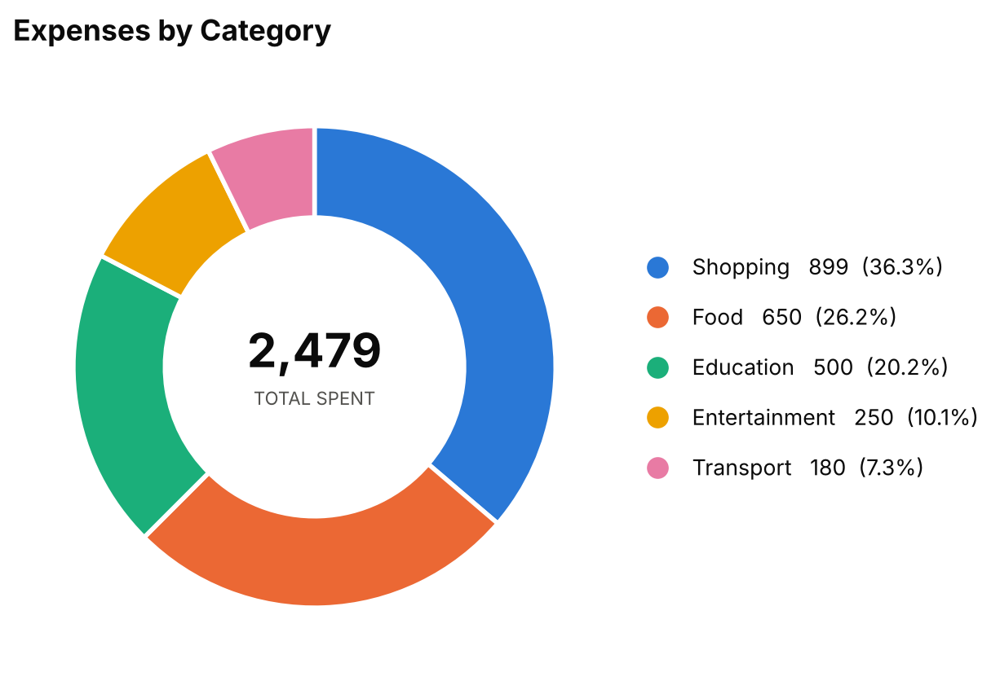

# Expense Tracker

A simple Python expense tracker with a clean browser UI, built by two people using Git.
Add expenses, filter by date or category, export CSV reports, and visualize spending with a donut chart, a bar chart, and a monthly trend chart.

## Features

* **Add & Validate Expenses**: Record expenses with date, amount (whole number or up to 1 decimal place), category, and optional notes

* **One-Click Delete**: Remove any expense row directly from the web table with confirmation

* **Flexible Time Filtering**: Switch between **All** records, **Today** shortcut, a specific **Date** picker, or **Month** dropdown

* **Category & Keyword Search**: Filter records, summary cards, and charts by category or keyword in notes

* **CSV Export**: Download currently filtered expenses as a UTF-8 CSV file (`Export CSV`)

* **Interactive Charts**: View spending via **Donut chart** (category share), **Bar chart** (amount per category), and **Monthly trend** (total per month), with full Chinese font support

* **Plain CSV Storage**: All records are persisted locally in `expenses.csv`

## Project structure

| File | Purpose | Owner | 
| ----- | ----- | ----- | 
| `expense_input.py` | Validate, store, and delete expenses in `expenses.csv` (CLI supported) | hsisophia | 
| `expense_app.py` | Web UI, time/category/keyword filters, and CSV export (standard library only) | hsisophia & sunyuen526 | 
| `expense_chart.py` | Donut and bar charts by category with Chinese font and 1-decimal support | sunyuen526 | 
| `expense_trend.py` | Monthly spending trend bar chart | hsisophia | 
| `sample_expenses.csv` | Bundled sample dataset for testing | \- | 
| `requirements.txt` | Python dependencies (`matplotlib`) | sunyuen526 | 

## Setup

```
python -m venv venv
venv\Scripts\activate
pip install -r requirements.txt

```

## Run

### Option 1 - Web UI (recommended)

```
python expense_app.py

```

Your browser opens at http://127.0.0.1:8000. Fill in the form (date, amount, category, optional notes) and click **Add expense**.
Use **All**, **Today**, **Date**, or **Month** to filter time ranges, narrow down by category or keyword, click **Export CSV** to download filtered results, or click **Delete** to remove a row.
Press `Ctrl+C` in the terminal to stop.

### Option 2 - Command line

```
python expense_input.py                        # add expenses in the terminal (saved to expenses.csv)
python expense_chart.py                        # writes pie_chart.png and bar_chart.png
python expense_trend.py                        # writes trend_chart.png
python expense_chart.py sample_expenses.csv    # try the bundled sample data

```

Data is stored in `expenses.csv` (columns: `date, amount, category, notes`).

## Sample output




## Troubleshooting

* **Chinese text shows as boxes in charts:** make sure the repository is up to date (`git pull`). On Windows the charts automatically use Microsoft JhengHei.

* **Page cannot be reached (`ERR_CONNECTION_REFUSED`):** start the server first with `python expense_app.py` and keep the terminal open.

## Git workflow

Development was organized across separate feature branches and merged via Pull Requests (`feature-input`, `feature-piechart`, `fix-chinese-font`, `feature-delete`, `feature-month-filter`, `feature-trend`, `feature-filters-export`).
See **Insights -> Network** on GitHub for the full branch and merge history.

## Demo video

https://youtu.be/aygy1tZ6S7E?si=ssbAW9agvJ2NuKmS

