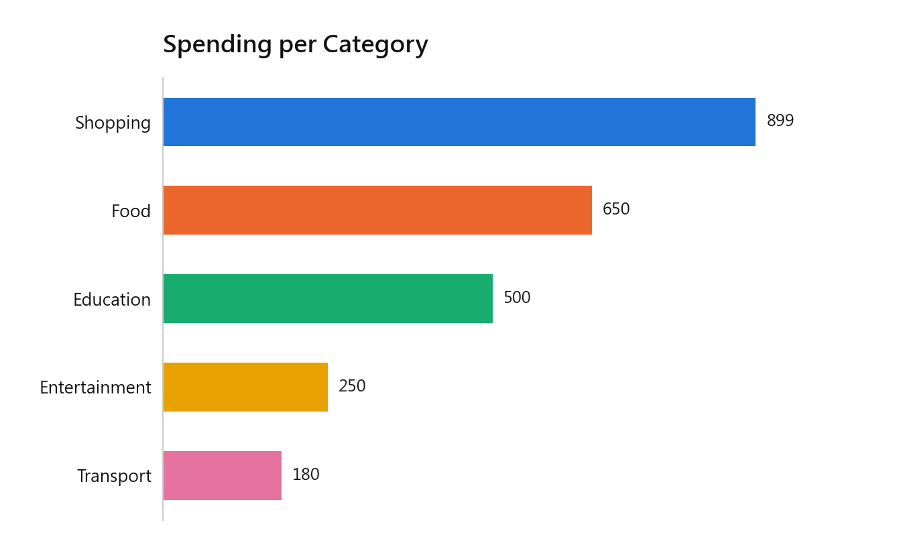

# Expense Tracker

A simple Python expense tracker with a clean browser UI, built by two people using Git.

| Module | Owner | File |
|---|---|---|
| Input (add & store expenses) | Member A | `expense_input.py`, `expense_app.py` |
| Visualization (pie / bar charts) | Member B | `expense_chart.py` |

## Setup

```bash
python3 -m venv venv && source venv/bin/activate   # Windows: venv\Scripts\activate
pip install matplotlib
```

## Run

### Option 1 - Web UI (recommended)

```bash
python expense_app.py
```

Your browser opens at http://127.0.0.1:8000. Fill in the form (date, amount, category, optional notes)
and click **Add expense**. The donut/bar chart and the table update automatically.
Press `Ctrl+C` in the terminal to stop.

### Option 2 - Command line

```bash
python expense_input.py                        # add expenses in the terminal (saved to expenses.csv)
python expense_chart.py                        # writes pie_chart.png and bar_chart.png
python expense_chart.py sample_expenses.csv    # try the bundled sample data
```

Data is stored in `expenses.csv` (columns: `date, amount, category, notes`).

## Sample output




## Demo video

<https://youtu.be/FgZRKpwEiok>
